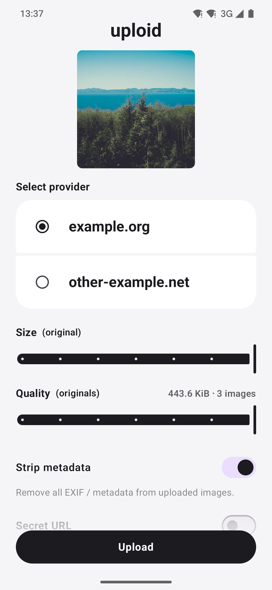
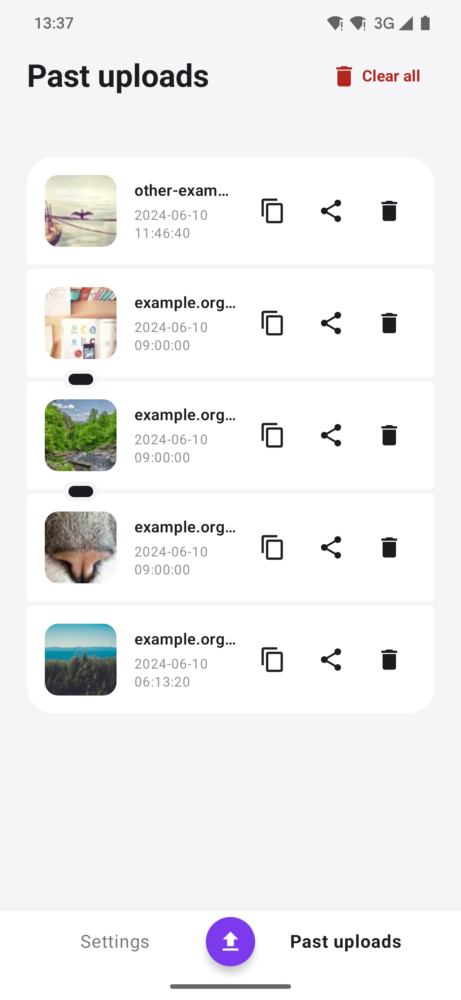

# uploid

uploid is a lightweight Android app built using Kotlin, Jetpack Compose, Room and OkHttp. It allows uploading images (or any file) to generic hosts via HTTP POST, supporting Basic HTTP Authentication, resizing/compressing of images, and viewing upload history.

## Screenshots

| Landing | Upload  |
| :---: | :---: |
|  |  |

| Upload (3 images) | History |
| :---: | :---: |
|  |  |

## License

GPL-3.0 License
